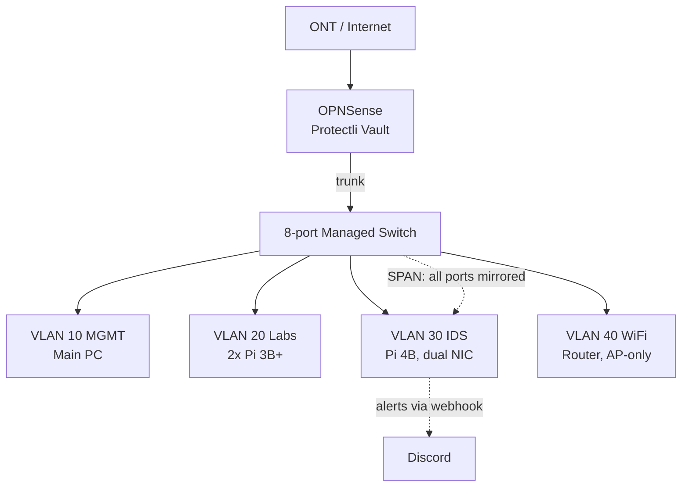

# Network Topology

VLAN-segmented star topology with OPNSense as the central router and firewall. Router-on-a-stick: one trunk from the switch to OPNSense carries all VLANs.

## Diagram



## VLANs

```
VLAN ID  |  Name        |  Subnet          |  Devices      | Services
---------------------------------------------------------------------------------------------

VLAN 10  | MGMT         | 192.168.10.0/24  | Main PC       | Infrastructure management / SSH out

VLAN 20  | Labs         | 192.168.20.0/24  | 2x Pi 3B+     | Security testing labs

VLAN 30  | IDS          | 192.168.30.0/24  | Pi 4B         | Suricata, Python alert daemon (systemd), log2ram, webhook script

VLAN 40  | WiFi         | 192.168.40.0/24  | Router        | AP-only mode
```

## Traffic Flow

* **Routing:** inter-VLAN traffic goes up to OPNSense, where firewall rules are applied.
* **Monitoring:** The switch mirrors all ports to the Pi 4B and Suricata inspects packets for intrusion detection.
* **Alerting:** Suricata alerts are parsed by a Python alert daemon running as a persistent systemd service and new alerts are piped to Discord via webhook.

## Build Phases

- [ ] Phase 1: OPNSense on the Protectli Vault
- [ ] Phase 2: Managed switch and VLANs
- [ ] Phase 3: Suricata on the Pi 4B

## Docs

<placeholder>
